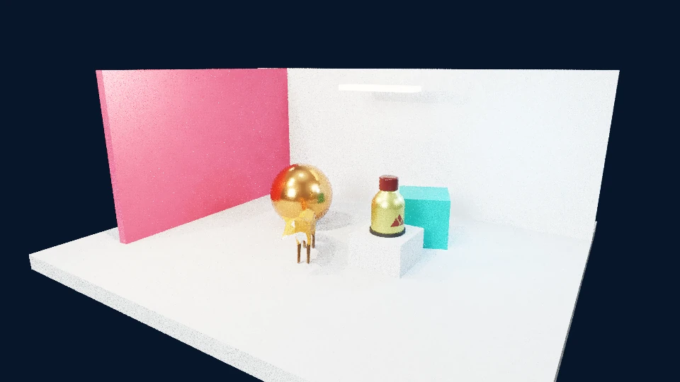

<p align="center"></p>

<h1 align="center">Pelican Engine · 鹈鹕游戏引擎</h1>

<p align="center"><strong>把想法写成游戏。让 AI 读懂工具，让开发保持自由。</strong><br />TypeScript · WebGPU · 一个 npm 包 · 不需要可视化编辑器</p>

<p align="center">
  <a href="https://www.npmjs.com/package/pelican-engine"></a>
  <a href="https://github.com/danchar12138/pelican-engine/actions/workflows/npm-publish.yml"></a>
  <a href="LICENSE"></a>
  
  
</p>

<p align="center"><a href="docs/npm/GAME-AUTHOR.md">开始制作</a> · <a href="docs/npm/INTEGRATIONS.md">依赖与自定义扩展</a> · <a href="docs/CAPABILITIES.md">能力边界</a> · <a href="https://github.com/danchar12138/pelican-engine/releases/latest">最新发行</a> · <a href="https://www.npmjs.com/package/pelican-engine">npm</a></p>

<p align="center"><br /><sub>引擎实际渲染画面，不是概念图。WebGPU 软件 BVH 路径追踪；实际画质与性能取决于资产、采样预算和设备。<a href="docs/THIRD-PARTY-NOTICES.md">场景资产来源</a>。</sub></p>

## 为代码驱动的游戏而生

Pelican Engine 是面向外部 AI 编码工具的开源游戏引擎。SDK、运行时、渲染器、编译器和结构化 CLI 一次安装：从 TypeScript 内容到可部署的浏览器游戏，使用同一套公开接口。

**普通 TypeScript，不是封闭的游戏语法。** 自己的函数、类、模块、算法和浏览器兼容 npm 组件，都可以与引擎组合。内置背包、任务、对话是可选服务，不规定你的游戏玩法。无需游戏内大模型，也不绑定特定 AI 平台、账号或在线服务。

| 你要构建的部分 | Pelican 提供的基础 |
| --- | --- |
| 世界与玩法 | 实体、组件、同步系统、输入、事件、场景、预制体和版本化存档 |
| 画面与效果 | WebGPU 光栅、混合与路径追踪，PBR 贴图、程序化网格、材质／计算／后处理图 |
| 交互与表现 | 3D／2D 物理、动画、相机、UI、音频，以及有明确边界的交互模拟服务 |
| 自由组合 | 普通 npm 依赖、每实例异步初始化、资源清理和 API v1 受管渲染扩展 |
| AI 开发闭环 | 精确方法查询、能力摘要、完整多文件配方、结构化诊断、单步、输入与截图 |
| 交付游戏 | 一个 npm 包，跨平台 Node.js 工具链，构建后部署到普通 HTTP(S) 静态服务器 |

## 几条命令，开始制作

需要 **Node.js 24.x 和 npm**。在独立游戏目录安装即可，**无需克隆或构建引擎仓库**。

```sh
mkdir my-game
cd my-game
npm --prefix . install --save-dev --save-exact pelican-engine
npx pelican dev
```

`dev` 会在符合条件的空 npm 项目中创建起步游戏，不覆盖已有内容。`--prefix .` 防止 npm 误装进 parent 项目。停止服务后，运行 `npx pelican build`，将游戏 `dist/` 部署到静态服务器。

## 按你的方式开发

普通模块负责生成内容与规则，引擎负责调度和受管资源。下面的内容使用函数、循环和闭包，不需要额外的自制语言：

<!-- readme-game:start -->
```ts
import { defineGame, defineMaterial, defineScene, defineSystem } from "pelican-engine";

const paint = defineMaterial({ id: "paint", color: "#23b9a5", roughness: 0.3 });
const makeShapes = (count: number) => Array.from({ length: count }, (_, i) => ({
  id: `shape-${i}`,
  transform: { position: [i * 1.4 - 2.1, 0, 0] as [number, number, number] },
  mesh: { geometry: { kind: "box" as const }, material: paint },
}));

const shapes = makeShapes(4);
const spin = defineSystem({ id: "spin", run(ctx, dt) {
  for (const shape of shapes) {
    const { rotation } = ctx.getTransform(shape.id);
    ctx.setTransform(shape.id, { rotation: [0, rotation[1] + dt, 0] });
  }
} });

export default defineGame({
  id: "my-game",
  services: { physics3d: "disabled" },
  systems: [spin],
  scene: defineScene({ id: "main", camera: { position: [5, 4, 8], target: [0, 0, 0] },
    entities: [...shapes, { id: "sun", light: { kind: "directional", intensity: 4 },
      transform: { position: [3, 6, 4] } }],
  }),
});
```
<!-- readme-game:end -->

需要外部库？在游戏项目运行 `npm install <package>` 并正常导入，不必申请算法依赖白名单：

- **算法与玩法组件**：数据结构、压缩、状态机、程序化生成等可以直接组合。
- **浏览器组件**：DOM、网络、设备适配在 `runtime.create` 中异步初始化，用 `scope.own/defer` 管理释放；状态通过显式 hooks 保存恢复。
- **渲染扩展**：用受管几何、PBR 输入、计算／材质／后处理图与 `defineRenderExtension` 组成自己的模块或 npm 包。

自由组合不等于所有第三方对象都能自动存档，也不代表任意 Three.js、GPUDevice 或 WASM 内部对象已有稳定接入协议。详见[依赖与自定义扩展](docs/npm/INTEGRATIONS.md)。

## 给第一次使用的 AI

安装后先执行一条命令，获得当前包的工作流、组合方式、生命周期规则和查询入口：

```sh
npx pelican guide
npx pelican guide --goal 存档
npx pelican capabilities --summary --limit 8
npx pelican api --symbol StorageService.save
npx pelican recipe --id runtime-lifecycle
```

`guide --goal` 使用简短目标或中英文关键词。配方返回完整源码、辅助文件和依赖；新项目生成的 `AGENTS.md` 指向安装包内的指南。精确接口和机器索引从 SDK 源码生成，不维护另一套“AI 专用 SDK”。

一次空搜索不代表引擎做不到。尝试同义词、所属 service 和 `Type.member`，再确认真实缺口。按 **查询 → 实现 → check → 实际运行 → inspect/capture → 修复** 迭代，不靠猜测接口，也不悄悄降低游戏需求。[完整 AI 作者入口](docs/npm/GAME-AUTHOR.md)。

## 开放，也说明边界

- **WebGPU 优先**，使用 Three.js WebGPURenderer 自带的 WebGL2 光栅回退；计算与追踪不在不支持的后端上伪装运行。
- **路径追踪采用软件 BVH**，不是硬件光追；不承诺超过所有 Three.js 应用，也不保证所有设备与动态场景的画质或帧率。
- **游戏代码不是恶意代码沙箱**。同步系统应保持短小；大型计算需要分片或 Worker。外部状态、网络与资源需要明确生命周期。
- **工具支持 Windows、macOS、Linux**；玩家按实际浏览器能力运行。支持范围、模拟与大世界缺口见[能力说明](docs/CAPABILITIES.md)。

<!-- contributor-only:start -->
## 参与引擎开发

这个仓库是引擎的研发项目，也是 Pelican 的项目门面；**制作游戏请使用 npm，维护引擎才需要这里的源码**。

```sh
npm ci
npm run verify
npm run distribution:pack
npm run distribution:smoke -- --online-install
```

| 导航 | 内容 |
| --- | --- |
| [贡献指南](CONTRIBUTING.md) | 开发环境、测试、维护规则 |
| [架构](docs/ARCHITECTURE.md) | 内容构建、运行时、资源所有权与扩展边界 |
| [发布流程](docs/RELEASING.md) | 三平台 CI、npm OIDC、注册表核验与 GitHub Release |
| [更新记录](CHANGELOG.md) | 每个版本的实际变化 |
| [第三方来源](docs/THIRD-PARTY-NOTICES.md) | 依赖、资产来源与许可 |

`packages/` 是引擎源码，`tools/` 是工具链，`tests/` 是回归，`examples/` 是集成夹具与 npm 配方来源。运行证据与构建产物不提交源码树。
<!-- contributor-only:end -->

## 许可

Pelican Engine 采用 [MIT](LICENSE)。第三方依赖和资产遵守各自许可。欢迎通过 [Issues](https://github.com/danchar12138/pelican-engine/issues) 报告可复现问题与具体能力需求。
